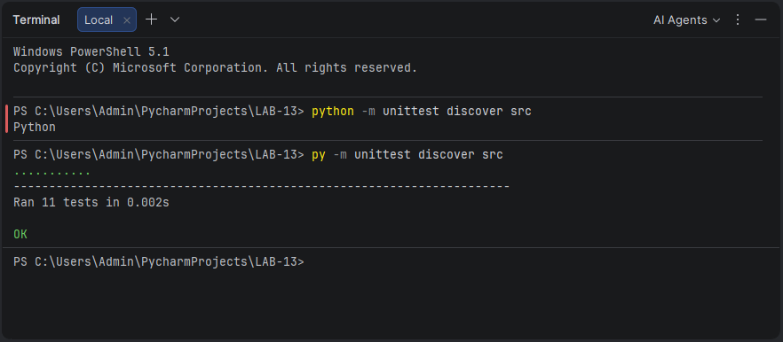

# Звіт до лабораторної роботи № 13

## Тема: Написання тестів з використанням unittest або pytest

**Виконав(ла):** _Міщенко Владислав_
**Група:** _КН-25-1_
**Варіант:** _14_

---

### 1. Опис завдання

> _Черга. Клас, що реалізує чергу з методами enqueue, dequeue та peek. Тести для перевірки правильності роботи черги_

---

### 2. Хід роботи

> _Опишіть послідовність ваших дій для виконання завдання. Які файли були створені, які функції/класи реалізовані, які тести написані._

### 3. Результати виконання

> __

```
<Результат виконання тестів>
```

---

### 4. Відповіді на контрольні запитання

**1. Яка різниця між методами `assertEqual`, `assertTrue`, `assertFalse` та `assertRaises` у модулі `unittest`? Наведіть приклади їх використання.**

> **Відповідь:** ...

**2. Що таке тестове покриття (code coverage) і чому воно важливе? Як виміряти тестове покриття в Python?**

> **Відповідь:** Покриття коду — це метрика, яка вимірює відсоток рядків коду, виконаних автоматизованими тестами. Мета вимірювання покриття коду — переконатися, що ваші тести ефективно тестують вашу кодову базу, а також виявити ділянки, які можуть бути недостатньо охопленими тестами.

**3. Як організувати тести у великому проєкті? Які є підходи до групування та запуску тестів?**

> **Відповідь:** Фреймворк модульного тестування unittest спочатку був натхненний JUnit і має подібний смак, як основні фреймворки модульного тестування іншими мовами. Він підтримує автоматизацію тестування, спільне використання коду налаштування та завершення тестів, об’єднання тестів у колекції та незалежність тестів від структури звітування.

**4. Що таке «mocking» і «patching» у тестуванні? Для чого вони використовуються і які проблеми можуть вирішити?**

> **Відповідь:** Mocking та patching у Python — це техніки ізоляції коду під час тестування, які дозволяють замінити реальні залежності (бази даних, API, системний час) на керовані імітації.

**5. Опишіть процес розробки через тестування (Test-Driven Development, TDD). Які його основні принципи та переваги?**

> **Відповідь:** Розробка через тестування (Test-Driven Development, TDD) — це підхід до створення програмного забезпечення, за якого автоматизовані тести пишуть до написання основного коду функціональності. Процес будується на повторенні коротких циклів «Червоний — Зелений — Рефакторинг» (Red-Green-Refactor).

---

### Висновки

> _Під час виконання лабораторної роботи, я здобув практичні навички у написанні модульних тестів (unit tests) для програмного коду на мові Python з використанням стандартної бібліотеки unittest. Створити тестові випадки (test cases), використовувати методи перевірки (assertions), організовувати тести в тестові набори (test suites) та запускати їх**_
